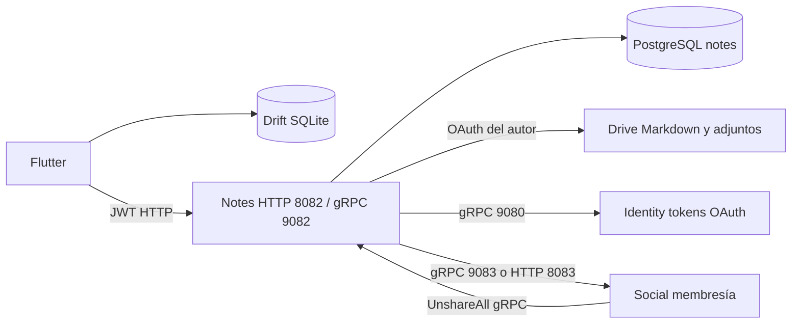
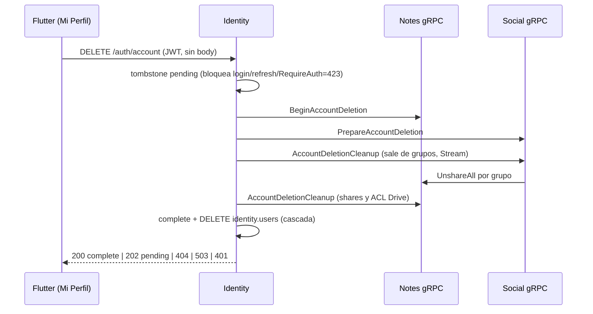

# Héctor Lepio — Notes y frontend, Sprint 3

Contrato contrastado con código del repositorio, revisión 2026-10-23 (borrado de
cuenta 3_2_16 integrado tras el PR #94 de Identity). Reemplaza
la auditoría anterior que describía Notes sin gRPC. Resultados y estados por
tarea: [SPRINT3_HECTOR_CIERRE](../SPRINT3_HECTOR_CIERRE.md).

## Alcance y fuentes

Notes sirve HTTP 8082 y `notes.v1.NotesService` gRPC 9082 con un mismo NoteService.
Hay **21 rutas HTTP: 19 con JWT y 2 públicas**, y **10 RPC**. La
[matriz de API y pruebas](notes_api_matrix.md) enlaza un documento Req/Res/Flujo/
Tests por ruta. El [contrato gRPC](../endpointDoc/GRPC-notes-NotesService.md)
describe los mensajes; no son serializaciones idénticas a las respuestas HTTP.

Fuentes: `back/notes/cmd/server/main.go`, `internal/handler/http/`,
`internal/handler/grpc/`, `internal/interceptor/`, `internal/service/`,
`internal/repository/` y `back/proto/notes/v1/notes.proto`. Schema inicial:
`docker/postgres/init.sql`; migraciones: `back/notes/db/migrations/`.
Frontend: `front/lib/core/database/`, `features/notes/all_notes_screen.dart`,
`features/groups/group_detail_screen.dart`, `notifications_bell.dart` y, para el
borrado de cuenta, `core/services/account_deletion_service.dart` y
`features/auth/account_deletion_dialog.dart`.

Los contratos maestros agentApiContract*.md son contexto histórico. Esta revisión
describe el código ejecutable: no existe HTTP Unsave. El borrado de cuenta lo
orquesta Identity (`DELETE /auth/account`); ver la sección final.

## Arquitectura y persistencia



notes.notes conserva identidad, autor, título, visibilidad, versión,
external_file_id, forked_from_note_id y sync_status. Markdown canónico vive en
Drive; SQLite conserva copia editable local. attachments/saved_notes/likes/
shared_notes son relaciones. idempotency_keys, drive_operations y
drive_managed_permissions permiten recuperar operaciones parciales.

Servicios son módulos Go independientes; no se importan entre sí. Notes obtiene
tokens del proveedor Identity gRPC; PGOAuthTokenStore SQL es legado. Restricted
todavía consulta el **email Google conectado** en identity.oauth_connections
mediante PGDriveEmailStore: esto no es obtención/renovación de tokens.
Sin DATABASE_URL se usa memoria y Drive mock. Con PG y STORAGE_MODE=drive se usa
Google real. Mock pierde archivos al reiniciar y no demuestra permisos Google.

## Autenticación y errores

HTTP privado y 9 RPC de usuario exigen JWT HS256, issuer apuntes-auth, audience
apuntes-client. Identidad desde token, nunca desde body. HTTP Authorization Bearer;
gRPC metadata authorization. UnshareAll gRPC exige x-internal-key=INTERNAL_API_KEY.
Los health son públicos; nginx oculta /api-*/internal/ y gRPC es interno.

Lectura: autor, pública, share link o miembro de al menos un grupo restricted.
Nota privada inaccesible devuelve 404 indistinguible de inexistente. Edición y
borrado requieren autor. Share requiere autor y miembro; Unshare autor o admin.
Fallback HTTP UnshareAll permite objetivo o admin: user_id es objetivo explícito.

```json
{"error":{"code":"not_found","message":"Nota no encontrada"}}
```

| HTTP | Códigos / significado |
| --- | --- |
| 400 | bad_request, invalid_title, invalid_visibility, invalid_subject_id, invalid_access_mode |
| 401 | unauthorized, invalid_token, token_expired |
| 403 | forbidden: permisos u OAuth ausente/revocado |
| 404 | not_found, note_unavailable; UUID de recurso mal formado también 404 |
| 409 | conflict (versión/clave), already_saved, already_liked |
| 413 | file_too_large, payload_too_large |
| 415 | unsupported_media_type |
| 429 | rate_limited (Copy, límite por proceso) |
| 500 | internal_error: DB/Social/error no tipado, sin filtrar SQL |
| 502 | internal_error: almacenamiento no disponible |

Mapeo tipado con errors.Is/As. Consultar errores específicos de cada endpoint.
201 Save/Like y 204 no tienen cuerpo JSON.

## Creación, edición e idempotencia

1. Flutter guarda fila temporal, owner_user_id, clave estable y snapshot original
   (title/content/visibility/subject_id), antes del POST.
2. POST /notes usa X-Idempotency-Key y espera hasta 45 s. Timeout es ambiguo y
   conserva intención; no prueba que el servidor no haya creado la nota.
3. Notes reclama (user_id, operation, key), hash y resource_id preasignado. Payload
   distinto con misma clave da conflicto. Lease en progreso: 2 min.
4. Inserta pending_drive, crea/adopta archivo por appProperties.notes_note_id,
   persiste external_file_id y marca synced. Drive tiene timeout de 15 s y hasta
   tres intentos transitorios. El request espera; no es fire-and-forget.
5. Ventana de replay completado: 24 h. Al vencer, PostgreSQL **conserva resource_id**
   y Create adopta la nota existente; no cambiar la clave por expiración.
6. promoteTempNote mueve contenido local vigente al UUID y borra temporal en una
   transacción Drift, incluso después de desmontar la pantalla. setState requiere
   mounted. Ediciones ocurridas durante POST se envían luego con PATCH; el replay
   conserva snapshot original para evitar conflicto de hash.

Rechazo definitivo de Drive limpia filas sin archivo; fallo ambiguo conserva
identidad recuperable. PG fallando después de Drive activa compensación/outbox.
Pruebas: phantom_note_test.go, rollback_test.go, idempotency_recoverable_test.go,
create_replay_expiry_test.go e idempotency_claim_integration_test.go.
PATCH usa lock por nota y version optimista; 409 exige resolver conflicto sin
pisar edición local. Create, Copy y Update usan la misma idempotencia durable en
`notes.idempotency_keys` (operation `create|copy|update`, replay 24 h, lease de
2 min para claims en progreso). El cliente envía una clave única por guardado en
PATCH, por lo que en la práctica solo protege reintentos de red.

## SQLite, sesiones, sincronización y borrado

Drift persiste owner_user_id, create_key, create_snapshot y note_tombstones.
Lista y FTS filtran dueño; filas legacy sin dueño no pertenecen a una cuenta
autenticada. Pantalla captura dueño y comprueba sesión durante sincronización.
AppDatabaseManager comparte conexión: acquire/release por pantalla y guard para
operaciones; dispose de pantalla no cierra SQLite. Cierre controlado al salir.

GET /notes/me pagina de 50 en 50 con límite defensivo de 40 páginas. Resolver
creaciones pendientes antes de fusionar evita temporal + UUID visibles a la vez.
Solo listado completo permite retirar tombstones confirmados ausentes del remoto.
Error de red no equivale a lista vacía.

Delete escribe intención durable antes de ocultar. HTTP 204/404 satisface borrado;
errores mantienen remote_pending. Si falta resolver el POST, conserva snapshot
oculto, obtiene UUID por replay y traslada borrado a ese UUID. GET excluye
tombstones para evitar resurrección. Backend elimina metadata primero y agenda
cleanup Drive. No requiere disponibilidad de Google para confirmar metadata.

Adjuntos offline (esquema SQLite v5): el Markdown guarda el placeholder
`attachment-pending://...` y los bytes van a `pending_note_attachments`
(placeholder, note_id, owner_user_id, nombre, MIME, bytes, uploaded_id) en la
misma transacción que la nota. Límites: 10 MB por archivo (igual que el backend)
y 100 MB pendientes por cuenta; si no caben, la nota se guarda y esos bytes
quedan solo en memoria con aviso al usuario. Al promover temp→UUID los adjuntos
se re-asocian en la misma transacción; borrar la nota borra sus pendientes.
Tras subir, `uploaded_id` actúa como recibo: si el PATCH falla o la app se
reinicia no se vuelve a subir. `needs_sync` queda en true hasta que el PATCH
remoto se confirma; recién entonces se eliminan las filas pendientes. La
migración v4→v5 agrega `needs_sync` (false) y la tabla sin tocar datos previos.
Pruebas: `front/test/app_database_migration_test.dart` (v4→v5, borrado,
re-asociación, aislamiento, cuota) y
`front/test/notes_sync_duplicates_regression_test.dart` (diálogo offline con
imagen, dos reinicios, una sola subida, sin huérfanos; PATCH fallido sin
re-subida).

## ACL y reconciliación

ACL deseado = unión de pública, shares link y emails de grupos restricted.
Persistir intención precede a modificar Drive. Guardar IDs de permisos permite
revocación; estados pending/in_sync/failed permiten reintento. Salir de un grupo
no revoca permisos aún requeridos por otro. Restricted usa email Google conectado,
que puede diferir del email de login.

GetAccess devuelve can_read/can_write/access_mode/visibility y convergencia
failed > pending > synced. Solo owner no público verifica OAuth remoto;
drive_connection_required ofrece reconexión sin inventar 403.

- Job ReconcilePendingNotes (default 30 s): outbox, ACL y huérfanos. Gracia de
  15 min para pending_drive; no recrea failed_sync con contenido vacío inventado.
- POST /notes/reconcile: borrados propios confirmados en Drive (404/papelera),
  cleanup normal y IDs para SQLite. Timeout/OAuth/error ambiguo conservan datos.

Social consume UnshareAll gRPC; HTTP está deprecado. Bufconn y E2E cubren
shares, retirada del miembro saliente, aislamiento del objetivo e idempotencia.

## Configuración

| Variable Notes | Default / propósito |
| --- | --- |
| DATABASE_URL | Vacío: memoria; configurada: PG |
| NOTES_PORT / PORT | Primera configurada, default 8082 |
| NOTES_GRPC_PORT / GRPC_PORT | Primera no vacía, default 9082 |
| JWT_SECRET / JWT | HS256; fallback solo desarrollo |
| INTERNAL_API_KEY | Clave interna común Notes/Social/Identity |
| STORAGE_MODE | mock; drive selecciona Google |
| IDENTITY_GRPC_ADDR | auth:9080 |
| SOCIAL_GRPC_ADDR | Si existe, gRPC para membresía/directorio |
| SOCIAL_SERVICE_URL | http://social:8083, fallback HTTP |
| SOCIAL_TIMEOUT | 5s; también limita adaptador gRPC |
| NOTES_RECONCILE_INTERVAL | 30s; duración positiva |
| GOOGLE_CLIENT_ID/SECRET | Legado SQL; proveedor gRPC no los usa |

Compose normal publica Notes 8082/9082. K8s Service/Deployment exponen ambos
internamente, con DNS de Social e Identity. E2E usa proyecto/red/volumen ti3-e2e:
HTTP 18082/18083/18085/18087, PostgreSQL 15432, gRPC interno por red Docker.
No hace falta publicar gRPC al host para conectividad entre contenedores.

```sh
docker compose --env-file /dev/null -f docker-compose.e2e.yml -p ti3-e2e up -d --build
python scripts/test-notes-e2e.py
```

Windows: --env-file NUL. Integración Go usa NOTES_TEST_DATABASE_URL y
SOCIAL_TEST_DATABASE_URL solo contra PostgreSQL aislado. Algunas pruebas crean/
dropear bases o schemas de prueba; nunca usar el .env de aplicación. No se
despliega al clúster ni se borran volúmenes existentes.

## Notificaciones y dependencias

Campana distingue carga/vacío/error, badge IgnorePointer, dedupe por ID, control
de cargas superpuestas/doble marcado y lectura optimista. Tests:
notifications_bell_state_test.dart. Social carece de UNIQUE(meeting_id,user_id):
dedupe por ID no elimina registros duplicados con IDs diferentes.

## Borrado de cuenta (3_2_16)

Backend (Agustín Vega, PR #94 en Development, commit `b1a148c`). Contratos:
[DELETE /auth/account](../endpointDoc/DELETE-auth-account.md) y
[GET /auth/account-deletion](../endpointDoc/GET-auth-account-deletion.md).



- Sin contraseña: el usuario sale solo del JWT. El cliente exige escribir
  `ELIMINAR`; el botón queda deshabilitado mientras no coincida.
- **Solicitud vs. borrado efectivo.** `200 complete`: los tres servicios
  confirmaron. `202 pending`: la solicitud quedó registrada y la cuenta ya está
  bloqueada, pero Social/Notes no confirmaron; el worker de Identity reintenta cada
  15 s sin JWT. El frontend lo muestra como «Eliminación en curso», nunca como
  éxito, y consulta `GET /auth/account-deletion` cada 4 s (15 veces) o a pedido.
- Notes conserva notas, adjuntos y archivos en el Drive del autor; solo retira
  comparticiones y permisos. El diálogo lo advierte.
- Ambigüedad: red, timeout (45 s), `503`, `403/409/5xx` o cuerpo inesperado →
  se consulta el estado antes de decidir. `not_started` habilita «Reintentar»;
  estado inconsultable deja solo «Consultar estado» (sin repetir a ciegas). El
  `503` puede llegar con el borrado ya iniciado (falla el commit final), por eso
  no se interpreta como «no comenzó».
- Un solo `DELETE` en vuelo por cuenta (futuro compartido estático) y acciones
  deshabilitadas mientras procesa; atrás/fuera del diálogo no lo cierran.
- `401`: `AuthedHttp` intenta un refresh (si sirve, reintenta una vez el DELETE,
  que es idempotente); si se rechaza, la sesión expira y el diálogo explica
  «Sesión expirada» sin borrar datos.
- Limpieza local solo tras `200 complete`, `404 account_not_found`, o cuando el
  usuario elige salir con el borrado pendiente (la cuenta ya es irrecuperable). Se
  cierra la sesión solo si sigue siendo la de esa cuenta (sin `/auth/logout`:
  Identity ya revocó los refresh tokens), se purgan en una transacción las notas,
  adjuntos pendientes y tombstones SQLite **de ese dueño** (otras cuentas y filas
  legacy intactas) y se olvida el correo de Recordarme si es el suyo. Si la sesión
  expira con el borrado pendiente (Identity rechaza el refresh), igual se purga.
- Las cachés en memoria (`ProfileService.current`, perfil, Drive, calendario)
  ya se reinician con el cambio de `SessionManager.revision`.
- UI: tarjeta «Cuenta» con badge «Zona de peligro» al final de Mi Perfil (no hay
  pantalla de ajustes) y diálogo con `NeobrutalistDialog` (nuevo parámetro
  `actions`), `NeobrutalistButton` danger con borde de 3 px y `NeobrutalistBadge`.
  Probado a 360×640, 768×1024 y 1440×900 con texto al 100 % y 200 %.

Pruebas: `front/test/account_deletion_service_test.dart` (contrato HTTP, estados,
single-flight, limpieza y purga SQLite real en memoria),
`front/test/account_deletion_flow_test.dart` (flujo desde Mi Perfil y responsive),
`back/auth/internal/handler/http/account_deletion_contract_test.go` y
`scripts/test-account-deletion-e2e.py` (stack ti3-e2e, cuentas sintéticas).
