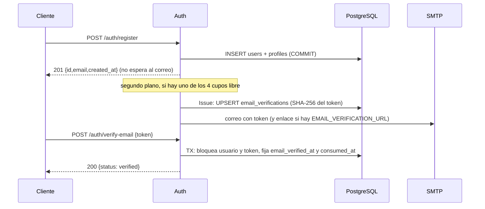

# Confirmación de cuenta por correo

Al registrarse, Auth envía un correo con un token de confirmación. Al canjearlo,
la cuenta queda marcada como confirmada (`identity.users.email_verified_at`).
Usa la misma cuenta SMTP que la [recuperación de contraseña](password-recovery.md)
(remitente predeterminado `Sigma Academy <sigmaacademy.noreply@gmail.com>`).

**Alcance:** Auth y Flutter. En el backend: SMTP, tokens, endpoints, la
migración 007, el gate de login/refresh (`EMAIL_VERIFICATION_REQUIRED`,
**apagado por defecto**), el backfill único de cuentas existentes (migración
008) y la confirmación por restablecimiento de contraseña. En Flutter: la
pantalla de confirmación por código, el reenvío y el manejo del login 403 (ver
«Frontend Flutter»).

## Endpoints

| Método y ruta | Uso | Documentación |
| --- | --- | --- |
| `POST /auth/register` | Sin cambios de contrato; tras crear la cuenta envía el primer correo | [POST-auth-register.md](../endpointDoc/Auth/Post/POST-auth-register.md) |
| `POST /auth/send-verification-email` | Solicitud y reenvío (respuesta genérica) | [POST-auth-send-verification-email.md](../endpointDoc/Auth/Post/POST-auth-send-verification-email.md) |
| `POST /auth/verify-email` | Canje del token | [POST-auth-verify-email.md](../endpointDoc/Auth/Post/POST-auth-verify-email.md) |

Ambas rutas nuevas son públicas y se exponen por nginx como `/api-auth/auth/...`.



## Configuración

| Variable | Obligatoria | Defecto | Descripción |
| --- | --- | --- | --- |
| `SMTP_HOST` | no | `smtp.gmail.com` | Servidor SMTP |
| `SMTP_PORT` | no | `587` | Puerto (1–65535) |
| `SMTP_USERNAME` | no | `sigmaacademy.noreply@gmail.com` | Usuario de autenticación |
| `SMTP_PASSWORD` | **sí, para enviar** | vacío | Contraseña de aplicación. Vacía = recuperación y confirmación deshabilitadas (503 `mail_unavailable`); el registro sigue funcionando |
| `SMTP_FROM` | no | `SMTP_USERNAME` | Remitente (dirección simple) |
| `SMTP_FROM_NAME` | no | `Sigma Academy` | Nombre visible |
| `SMTP_TLS_MODE` | no | `starttls` | `starttls` (587) o `tls` implícito (465). No existe modo sin cifrar |
| `EMAIL_VERIFICATION_URL` | no | vacío | Base del enlace del correo; se añade `?token=...`. https absoluta sin fragmento (http solo en localhost). Vacía = el correo trae solo el código |
| `EMAIL_VERIFICATION_TTL` | no | `24h` | Vigencia del token, duración Go entre `15m` y `168h` |
| `EMAIL_VERIFICATION_REQUIRED` | no | `false` | Gate de login/refresh para cuentas sin confirmar (`true`/`false`; otro valor detiene el arranque). Con `true` Auth exige 007 + 008 aplicadas y SMTP configurado, o no arranca |

- **Validación al arrancar:** con `SMTP_PASSWORD` presente, una configuración
  SMTP mal formada detiene Auth (`config SMTP: ...`). Un
  `EMAIL_VERIFICATION_URL` o `EMAIL_VERIFICATION_TTL` inválido también
  (`config email verification: ...`). Los mensajes nombran la variable, nunca su valor.
- Líneas de arranque: `email verification: enabled=<bool> link_configured=<bool> ttl=24h0m0s` y
  `email verification gate: required=<bool> reset_marks_verified=<bool> residual_access_max=15m0s`.
- Si falta la migración 007, Auth arranca con la advertencia
  `ADVERTENCIA confirmación de correo sin esquema`; el registro sigue funcionando.
- **Enlace:** el frontend todavía no tiene una ruta que reciba `?token=`. Hasta
  esa tarea conviene dejar `EMAIL_VERIFICATION_URL` vacío; el correo trae el
  código para canjearlo con `POST /auth/verify-email`. La ruta debe leer el
  parámetro y hacer `POST`; nunca un `GET` que confirme, porque los escáneres
  de enlaces de los clientes de correo lo abrirían solos.
- Ningún secreto queda versionado: `SMTP_PASSWORD` vive en el `.env` privado o
  en `ti3-secrets` (ver `password-recovery.md`).

## Migración `back/auth/db/migrations/007_email_verification.sql`

- `identity.users.email_verified_at timestamptz` (NULL = sin confirmar).
- `identity.email_verifications`: una fila por usuario (`user_id` PK, FK con
  `ON DELETE CASCADE`), `token_hash bytea` único de 32 bytes (`CHECK`),
  `expires_at`, `requested_at`, `window_started_at`, `sends_in_window`,
  `consumed_at`.
- Aditiva e idempotente (`IF NOT EXISTS`); también incluida en
  `docker/postgres/init.sql` para bases nuevas (mismo esquema, comprobado).
  No rellena usuarios existentes: quedan con `email_verified_at` NULL, sin
  efecto mientras no exista el gate de login.
- El proyecto no usa migraciones `down`. **Rollback:** revertir la aplicación;
  la tabla y la columna pueden quedarse sin afectar la versión anterior. Si
  hubiera que retirarlas: `DROP TABLE identity.email_verifications;` y
  `ALTER TABLE identity.users DROP COLUMN email_verified_at;` (pierde qué
  cuentas confirmaron).
- Sin 007, Auth funciona con el gate apagado (login, refresh, registro y
  recuperación sin cambios); el reenvío falla en segundo plano con
  `sqlstate=42703` y el canje responde 500. Con el gate encendido, Auth no arranca.

## Migración `back/auth/db/migrations/008_email_verification_backfill.sql`

- Marca como confirmadas, **una sola vez**, las cuentas que existían antes de
  exigir la confirmación, para que el gate no bloquee a usuarios antiguos.
- Tabla de control `identity.email_verification_backfill`: una única fila
  (`id boolean` PK con `CHECK (id)`) con `cutoff`, `accounts_marked` y
  `applied_at`. Si la fila existe, la migración no hace nada: reaplicarla nunca
  confirma cuentas posteriores.
- `init.sql` crea la tabla **con la fila ya insertada** (0 cuentas): una base
  nueva nunca hace backfill aunque luego se le apliquen las migraciones.
- Atomicidad: todo el backfill es un bloque `DO` (una sentencia, una
  transacción, también con `psql -f` en autocommit como se aplican las
  migraciones en Pillán). `LOCK TABLE identity.users IN SHARE ROW EXCLUSIVE
  MODE` espera a las altas en curso y bloquea las nuevas hasta el `COMMIT`
  (dura lo que el `UPDATE`). El corte queda en «cuentas confirmadas en la base
  al tomar el bloqueo»: los registros simultáneos esperan y quedan después del
  corte, sin confirmar. También serializa dos ejecuciones simultáneas de 008.
- Solo cambia `email_verified_at IS NULL` (fecha = corte); nunca sobrescribe
  una confirmación previa. Sin 007 falla con un mensaje claro y no deja la fila.
- **Rollback:** la fila de control documenta qué se hizo (`cutoff`,
  `accounts_marked`). Para deshacerlo: `UPDATE identity.users SET
  email_verified_at = NULL WHERE email_verified_at = (SELECT cutoff FROM
  identity.email_verification_backfill);` y borrar la fila.

## Orden de despliegue

1. Aplicar la migración 007.
2. Aplicar la migración 008 **mientras sigue en servicio la versión anterior
   de Auth**: el corte deja fuera a las cuentas creadas por la versión nueva.
3. Desplegar Auth nuevo con `EMAIL_VERIFICATION_REQUIRED=false`.
4. Desplegar Flutter con la pantalla de confirmación y el reenvío.
5. Activar `EMAIL_VERIFICATION_REQUIRED=true`.

Consecuencia esperada: las cuentas creadas por la versión anterior entre el
paso 2 y el 3 quedan sin confirmar y **no recibieron correo**. Con el gate
activo reciben `403 email_not_verified` y deben pedir el reenvío (paso 4). Las
cuentas creadas desde el paso 3 reciben el correo al registrarse.

## Gate de login y sesiones existentes

- Solo `POST /auth/login` y `POST /auth/refresh` emiten sesiones; ambos aplican
  el gate después de validar credenciales/refresh y estado de borrado, y antes
  de emitir tokens. Registro, recuperación, confirmación, conexiones Google,
  `/internal/*` y gRPC no emiten sesiones.
- Login → `403 email_not_verified` (solo con la contraseña correcta: no permite
  enumerar cuentas). Refresh → `401 email_not_verified` (el Flutter actual solo
  cierra la sesión ante un 401); el refresh no se revoca y vuelve a servir tras
  confirmar. Un fallo al consultar → 500, sin sesión.
- **JWT ya emitidos:** el gate no los invalida. Auth, Notes y Social validan el
  JWT localmente (firma, emisor, audiencia y `exp`; Auth siempre firma con
  `exp`). Una cuenta sin confirmar con una sesión anterior a la activación
  conserva acceso como máximo hasta que expire su access token
  (`ACCESS_TOKEN_EXPIRES_IN`, 900 s por defecto; no se sobrescribe en ningún
  despliegue del repositorio). Después, el refresh se rechaza y la sesión
  termina: el acceso nunca es indefinido.
- No se añadió una consulta por petición: el riesgo residual es de 15 minutos
  y solo afecta a cuentas creadas por la versión nueva que iniciaron sesión con
  el gate apagado. Comprobarlo en cada petición exigiría consultar
  `identity.users` desde Notes y Social (hoy solo validan el JWT y su propia
  tabla de borrados) o un claim nuevo en el JWT.
- **Restablecimiento de contraseña:** si la 007 estaba aplicada al arrancar,
  un restablecimiento exitoso confirma el correo en la misma sentencia que
  cambia la contraseña (`COALESCE(email_verified_at, now())`), solo tras
  validar el código enviado a esa dirección.

## Protección y decisiones de diseño

- **Token:** 32 bytes de `crypto/rand` en base64url (43 caracteres, 256 bits).
  Solo se guarda su SHA-256; se busca por índice único. Con esa entropía no hace
  falta bcrypt (que además impediría indexarlo) ni límite de intentos en el canje.
- **Uso único y reemplazo:** cada emisión reemplaza el token anterior (queda
  inválido al instante). El canje fija `consumed_at` y `email_verified_at` en
  la misma transacción.
- **Concurrencia:** emisión y canje bloquean primero la fila del usuario
  (`FOR NO KEY UPDATE`) y después la del token. Dos canjes simultáneos: uno
  `verified`, el resto `already_verified`. Emisión y canje simultáneos: sin
  interbloqueos ni estados intermedios. El canje vuelve a comprobar `user_id`
  y `token_hash` bajo bloqueo, así que un token solo confirma su propia cuenta.
- **Abuso:** 60 s entre envíos y máximo 5 por hora por cuenta, evaluados en el
  mismo `UPSERT` (válido con varias réplicas). Auth no tiene rate limiting por
  IP y no se añadió uno global en esta tarea.
- **Anti-enumeración:** `send-verification-email` responde igual para correos
  desconocidos, cuentas confirmadas, límites y fallos de envío, y el envío
  ocurre fuera de la petición para que el tiempo de respuesta tampoco delate la
  cuenta. `503 mail_unavailable` y `500` no dependen de la cuenta.
- **Envío en segundo plano y límite de 4:** registro y reenvío usan el mismo
  despacho (`dispatchSend`). Antes de crear la goroutine se intenta ocupar uno
  de 4 cupos sin esperar; sin cupo, el envío se descarta al instante
  (`status=skipped reason=busy`) antes de generar o guardar token, sin gastar
  enfriamiento ni tope, y la persona puede reenviar. El cupo se libera siempre
  (`defer`, también ante error o panic). Así nunca hay más de 4 goroutines de
  envío por réplica y queda libre al menos una de las 5 conexiones del pool
  para login. Ni el `201` del registro ni el `200` del reenvío esperan al SMTP.
- **Fallo de correo tras el registro:** el usuario ya está creado (COMMIT) y la
  respuesta sigue siendo `201`. No hay estado inconsistente: o hay token
  emitido, o no lo hay y el reenvío lo crea. Repetir el registro devuelve
  `409 email_taken`; nunca duplica la cuenta.
- **Reintento:** si el SMTP falla, Auth libera el enfriamiento de ese token para
  permitir un reenvío inmediato (el tope por hora se mantiene). El token no se
  borra, porque un fallo tardío (después de `DATA`) no garantiza que el correo
  no haya salido. No hay cola de reintentos automáticos: el reintento es el
  endpoint de reenvío (botón en una tarea posterior del front). Un envío en
  curso se pierde si Auth se reinicia; la persona puede volver a pedirlo.
- **SMTP:** STARTTLS obligatorio (aborta si el servidor no lo anuncia, sin
  enviar credenciales) o TLS implícito; TLS 1.2+. Destinatarios y remitente
  validados contra inyección de cabeceras. Errores tipados por etapa y código
  SMTP, sin el texto de la respuesta del servidor. `SMTPMailer` es el mismo
  componente para recuperación y confirmación (`ResetMailer` se generalizó).

## Logs

Formato `[auth]`, igual que `logAuthOp`. Una línea por petición HTTP y una por
etapa del servicio (`step=lookup|dispatch|persist|send|release_cooldown|validate|confirm|mailer`).
Nunca contienen token, hash, enlace, correo, contraseña, credenciales SMTP ni
el texto de errores de SMTP o PostgreSQL (solo `smtp_stage`, `smtp_code`,
`sqlstate`):

```text
[auth] email-verification op=Register user_id=<uuid> step=send status=ok outcome=sent
[auth] email-verification op=Register user_id=<uuid> step=send status=error smtp_stage=dial
[auth] email-verification op=Register user_id=<uuid> step=dispatch status=skipped reason=busy
[auth] POST /auth/send-verification-email op=SendVerificationEmail status=200 user_id=- accepted=true duration_ms=2
[auth] email-verification op=SendVerificationEmail user_id=<uuid> step=persist status=skipped outcome=throttled
[auth] POST /auth/verify-email op=VerifyEmail status=200 user_id=- outcome=verified duration_ms=5
[auth] email-verification op=VerifyEmail user_id=<uuid> step=confirm status=rejected outcome=expired
```

## Pruebas

- Unitarias y handler: `cd back/auth` y `go test ./...` (incluye un servidor
  SMTP falso con TLS que ejercita STARTTLS, TLS implícito, AUTH, rechazos 535/550,
  timeout y la negativa a autenticar sin cifrado).
- Integración PostgreSQL (BD vacía y dedicada, como el resto de Auth):
  `AUTH_TEST_DATABASE_URL=... go test ./internal/service/ -p 1 -run TestAuthIntegration_EmailVerification -count=1 -v`.
  CI las ejecuta en el job `integration` de `test-auth` (prefijo `TestAuthIntegration_`).
- Migraciones: `scripts/validate-migrations.sh` (job `test-migrations`).
- Gate y backfill: `TestEmailGate_*` (unitarios), `TestE2E_EmailVerificationGate_*`
  (HTTP, job `e2e`) y `TestAuthIntegration_EmailVerification_Backfill*`,
  `..._GateLoginRefreshFlow`, `..._GateSchemaReady`,
  `..._PasswordResetMarksVerified` (PostgreSQL). Las suites E2E entre
  servicios no cambian: el gate está apagado por defecto.
- Prueba manual pendiente con SMTP real: registrar una cuenta propia de prueba,
  recibir el correo, canjear el código con `POST /auth/verify-email`, comprobar
  `email_verified_at`, reabrir el código (`already_verified`) y pedir un
  reenvío (sin correo nuevo para una cuenta confirmada).

## Frontend Flutter

Confirmación por **código pegado**: sin enlaces ni deep links.
`EMAIL_VERIFICATION_URL` queda vacía y el correo trae el código de 43
caracteres en una línea propia.

- **Cliente** (`front/lib/core/services/auth_service.dart`):
  - `sendVerificationEmail(email)` → `LoginResult`;
  - `verifyEmail(token)` → `VerifyEmailResult` (`verified`, `alreadyVerified`,
    `invalid`, `failed`);
  - `LoginResult.errorCode` conserva el `error.code` del login
    (`AuthService.emailNotVerifiedCode`).
- **Pantalla** `EmailVerificationScreen`
  (`front/lib/features/auth/email_verification_screen.dart`):
  - correo precargado y campo para pegar el código (se recortan los espacios
    de los extremos);
  - «CONFIRMAR», «Reenviar correo» con cuenta atrás de 60 s y «Volver al
    inicio de sesión»;
  - estados de carga que deshabilitan los botones.
- **Confirmar:**
  - `verified` / `already_verified` → aviso «Ya puedes iniciar sesión» y
    vuelta al login, **sin** iniciar sesión ni renovar la anterior;
  - `invalid` → «El código es inválido, expiró o fue reemplazado…»;
  - error de red o servidor → su mensaje, sin salir de la pantalla.
- **Reenviar:**
  - 200 → aviso genérico (no revela si la cuenta existe y recomienda revisar
    spam) y cuenta atrás;
  - 503 `mail_unavailable` o sin conexión → su mensaje, sin afirmar que el
    correo salió.
- **Registro:** «CUENTA CREADA - CONFIRMA TU CORREO», correo copiado al
  formulario de login y apertura de la pantalla con la cuenta atrás iniciada
  (el registro ya envió el correo). No inicia sesión.
- **Login 403 `email_not_verified`:** diálogo «Confirma tu correo»
  (`front/lib/features/auth/email_not_verified_dialog.dart`) con:
  - «Reenviar correo»: llama al endpoint con el diálogo abierto (indicador y
    botones deshabilitados, sin solicitudes duplicadas). Si se acepta, cierra
    el diálogo y abre la pantalla; si falla (503, red), muestra el error en el
    diálogo, sin afirmar que el correo salió, y permite reintentar;
  - «Tengo un código»: abre la pantalla con el correo del formulario;
  - «Cancelar».

  Credenciales incorrectas, errores de red y demás conservan el aviso de
  siempre. Enlace fijo «¿Tienes un código de confirmación?» en el login.
  `LoginScreen` impide abrir dos veces el diálogo o la pantalla (doble
  toque) y libera la protección al volver o cancelar.
- **Refresh `401 email_not_verified`:** sin cambios en `AuthedHttp` ni en
  `SessionManager`. Es un refresh rechazado: la sesión se cierra una vez, sin
  reintentos, y la app vuelve al login con «Tu sesión expiró»; el correo
  recordado se conserva. Tras confirmar, la persona inicia sesión de nuevo.
- **Pruebas:**
  - `front/test/email_verification_test.dart` (servicio y pantalla);
  - `front/test/login_email_verification_test.dart` (login y registro);
  - `front/test/auth_service_test.dart` (login 403/401);
  - `front/test/session_refresh_test.dart` (refresh 401
    `email_not_verified`, una sola expiración).

  Ejecutarlas con `flutter test --no-pub` para no reescribir `pubspec.lock`.

## Pendiente para tareas posteriores

- Activar `EMAIL_VERIFICATION_REQUIRED=true` después de desplegar Flutter.
- Opcional: aviso específico en lugar de «Tu sesión expiró» cuando el refresh
  responde `email_not_verified` (exige pasar el motivo por la lógica de sesión).
- Opcional: enlace de confirmación para web (token en el fragmento, P3) y
  `EMAIL_VERIFICATION_URL`.
- Exponer el estado de confirmación (p. ej. en `GET /profile/me`) si el front lo necesita.
