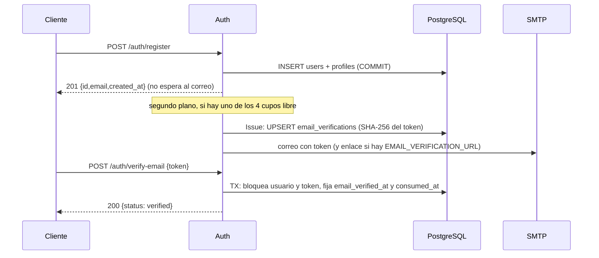

# Confirmación de cuenta por correo

Al registrarse, Auth envía un correo con un token de confirmación. Al canjearlo,
la cuenta queda marcada como confirmada (`identity.users.email_verified_at`).
Usa la misma cuenta SMTP que la [recuperación de contraseña](password-recovery.md)
(remitente predeterminado `Sigma Academy <sigmaacademy.noreply@gmail.com>`).

**Alcance de esta etapa:** solo la infraestructura backend (SMTP, tokens,
endpoints, migración). **No** bloquea el login de cuentas sin confirmar, **no**
rellena (backfill) usuarios existentes y **no** incluye pantallas Flutter. Esas
partes son tareas posteriores.

## Endpoints

| Método y ruta | Uso | Documentación |
| --- | --- | --- |
| `POST /auth/register` | Sin cambios de contrato; tras crear la cuenta envía el primer correo | [POST-auth-register.md](../endpointDoc/Auth/Post/POST-auth-register.md) |
| `POST /auth/send-verification-email` | Solicitud y reenvío (respuesta genérica) | [POST-auth-send-verification-email.md](../endpointDoc/Auth/Post/POST-auth-send-verification-email.md) |
| `POST /auth/verify-email` | Canje del token | [POST-auth-verify-email.md](../endpointDoc/Auth/Post/POST-auth-verify-email.md) |

Ambas rutas nuevas son públicas y se exponen por nginx como `/api-auth/auth/...`.



## Configuración

| Variable | Obligatoria | Defecto | Descripción |
| --- | --- | --- | --- |
| `SMTP_HOST` | no | `smtp.gmail.com` | Servidor SMTP |
| `SMTP_PORT` | no | `587` | Puerto (1–65535) |
| `SMTP_USERNAME` | no | `sigmaacademy.noreply@gmail.com` | Usuario de autenticación |
| `SMTP_PASSWORD` | **sí, para enviar** | vacío | Contraseña de aplicación. Vacía = recuperación y confirmación deshabilitadas (503 `mail_unavailable`); el registro sigue funcionando |
| `SMTP_FROM` | no | `SMTP_USERNAME` | Remitente (dirección simple) |
| `SMTP_FROM_NAME` | no | `Sigma Academy` | Nombre visible |
| `SMTP_TLS_MODE` | no | `starttls` | `starttls` (587) o `tls` implícito (465). No existe modo sin cifrar |
| `EMAIL_VERIFICATION_URL` | no | vacío | Base del enlace del correo; se añade `?token=...`. https absoluta sin fragmento (http solo en localhost). Vacía = el correo trae solo el código |
| `EMAIL_VERIFICATION_TTL` | no | `24h` | Vigencia del token, duración Go entre `15m` y `168h` |

- **Validación al arrancar:** con `SMTP_PASSWORD` presente, una configuración
  SMTP mal formada detiene Auth (`config SMTP: ...`). Un
  `EMAIL_VERIFICATION_URL` o `EMAIL_VERIFICATION_TTL` inválido también
  (`config email verification: ...`). Los mensajes nombran la variable, nunca su valor.
- Línea de arranque: `email verification: enabled=<bool> link_configured=<bool> ttl=24h0m0s`.
- Si falta la migración 007, Auth arranca con la advertencia
  `ADVERTENCIA confirmación de correo sin esquema`; el registro sigue funcionando.
- **Enlace:** el frontend todavía no tiene una ruta que reciba `?token=`. Hasta
  esa tarea conviene dejar `EMAIL_VERIFICATION_URL` vacío; el correo trae el
  código para canjearlo con `POST /auth/verify-email`. La ruta debe leer el
  parámetro y hacer `POST`; nunca un `GET` que confirme, porque los escáneres
  de enlaces de los clientes de correo lo abrirían solos.
- Ningún secreto queda versionado: `SMTP_PASSWORD` vive en el `.env` privado o
  en `ti3-secrets` (ver `password-recovery.md`).

## Migración `back/auth/db/migrations/007_email_verification.sql`

- `identity.users.email_verified_at timestamptz` (NULL = sin confirmar).
- `identity.email_verifications`: una fila por usuario (`user_id` PK, FK con
  `ON DELETE CASCADE`), `token_hash bytea` único de 32 bytes (`CHECK`),
  `expires_at`, `requested_at`, `window_started_at`, `sends_in_window`,
  `consumed_at`.
- Aditiva e idempotente (`IF NOT EXISTS`); también incluida en
  `docker/postgres/init.sql` para bases nuevas (mismo esquema, comprobado).
  No rellena usuarios existentes: quedan con `email_verified_at` NULL, sin
  efecto mientras no exista el gate de login.
- El proyecto no usa migraciones `down`. **Rollback:** revertir la aplicación;
  la tabla y la columna pueden quedarse sin afectar la versión anterior. Si
  hubiera que retirarlas: `DROP TABLE identity.email_verifications;` y
  `ALTER TABLE identity.users DROP COLUMN email_verified_at;` (pierde qué
  cuentas confirmaron).
- **Orden de despliegue:** migración 007 → Auth → (más adelante) front.

## Protección y decisiones de diseño

- **Token:** 32 bytes de `crypto/rand` en base64url (43 caracteres, 256 bits).
  Solo se guarda su SHA-256; se busca por índice único. Con esa entropía no hace
  falta bcrypt (que además impediría indexarlo) ni límite de intentos en el canje.
- **Uso único y reemplazo:** cada emisión reemplaza el token anterior (queda
  inválido al instante). El canje fija `consumed_at` y `email_verified_at` en
  la misma transacción.
- **Concurrencia:** emisión y canje bloquean primero la fila del usuario
  (`FOR NO KEY UPDATE`) y después la del token. Dos canjes simultáneos: uno
  `verified`, el resto `already_verified`. Emisión y canje simultáneos: sin
  interbloqueos ni estados intermedios. El canje vuelve a comprobar `user_id`
  y `token_hash` bajo bloqueo, así que un token solo confirma su propia cuenta.
- **Abuso:** 60 s entre envíos y máximo 5 por hora por cuenta, evaluados en el
  mismo `UPSERT` (válido con varias réplicas). Auth no tiene rate limiting por
  IP y no se añadió uno global en esta tarea.
- **Anti-enumeración:** `send-verification-email` responde igual para correos
  desconocidos, cuentas confirmadas, límites y fallos de envío, y el envío
  ocurre fuera de la petición para que el tiempo de respuesta tampoco delate la
  cuenta. `503 mail_unavailable` y `500` no dependen de la cuenta.
- **Envío en segundo plano y límite de 4:** registro y reenvío usan el mismo
  despacho (`dispatchSend`). Antes de crear la goroutine se intenta ocupar uno
  de 4 cupos sin esperar; sin cupo, el envío se descarta al instante
  (`status=skipped reason=busy`) antes de generar o guardar token, sin gastar
  enfriamiento ni tope, y la persona puede reenviar. El cupo se libera siempre
  (`defer`, también ante error o panic). Así nunca hay más de 4 goroutines de
  envío por réplica y queda libre al menos una de las 5 conexiones del pool
  para login. Ni el `201` del registro ni el `200` del reenvío esperan al SMTP.
- **Fallo de correo tras el registro:** el usuario ya está creado (COMMIT) y la
  respuesta sigue siendo `201`. No hay estado inconsistente: o hay token
  emitido, o no lo hay y el reenvío lo crea. Repetir el registro devuelve
  `409 email_taken`; nunca duplica la cuenta.
- **Reintento:** si el SMTP falla, Auth libera el enfriamiento de ese token para
  permitir un reenvío inmediato (el tope por hora se mantiene). El token no se
  borra, porque un fallo tardío (después de `DATA`) no garantiza que el correo
  no haya salido. No hay cola de reintentos automáticos: el reintento es el
  endpoint de reenvío (botón en una tarea posterior del front). Un envío en
  curso se pierde si Auth se reinicia; la persona puede volver a pedirlo.
- **SMTP:** STARTTLS obligatorio (aborta si el servidor no lo anuncia, sin
  enviar credenciales) o TLS implícito; TLS 1.2+. Destinatarios y remitente
  validados contra inyección de cabeceras. Errores tipados por etapa y código
  SMTP, sin el texto de la respuesta del servidor. `SMTPMailer` es el mismo
  componente para recuperación y confirmación (`ResetMailer` se generalizó).

## Logs

Formato `[auth]`, igual que `logAuthOp`. Una línea por petición HTTP y una por
etapa del servicio (`step=lookup|dispatch|persist|send|release_cooldown|validate|confirm|mailer`).
Nunca contienen token, hash, enlace, correo, contraseña, credenciales SMTP ni
el texto de errores de SMTP o PostgreSQL (solo `smtp_stage`, `smtp_code`,
`sqlstate`):

```text
[auth] email-verification op=Register user_id=<uuid> step=send status=ok outcome=sent
[auth] email-verification op=Register user_id=<uuid> step=send status=error smtp_stage=dial
[auth] email-verification op=Register user_id=<uuid> step=dispatch status=skipped reason=busy
[auth] POST /auth/send-verification-email op=SendVerificationEmail status=200 user_id=- accepted=true duration_ms=2
[auth] email-verification op=SendVerificationEmail user_id=<uuid> step=persist status=skipped outcome=throttled
[auth] POST /auth/verify-email op=VerifyEmail status=200 user_id=- outcome=verified duration_ms=5
[auth] email-verification op=VerifyEmail user_id=<uuid> step=confirm status=rejected outcome=expired
```

## Pruebas

- Unitarias y handler: `cd back/auth` y `go test ./...` (incluye un servidor
  SMTP falso con TLS que ejercita STARTTLS, TLS implícito, AUTH, rechazos 535/550,
  timeout y la negativa a autenticar sin cifrado).
- Integración PostgreSQL (BD vacía y dedicada, como el resto de Auth):
  `AUTH_TEST_DATABASE_URL=... go test ./internal/service/ -p 1 -run TestAuthIntegration_EmailVerification -count=1 -v`.
  CI las ejecuta en el job `integration` de `test-auth` (prefijo `TestAuthIntegration_`).
- Migraciones: `scripts/validate-migrations.sh` (job `test-migrations`).
- Prueba manual pendiente con SMTP real: registrar una cuenta propia de prueba,
  recibir el correo, canjear el código con `POST /auth/verify-email`, comprobar
  `email_verified_at`, reabrir el código (`already_verified`) y pedir un
  reenvío (sin correo nuevo para una cuenta confirmada).

## Pendiente para tareas posteriores

- Gate de login para cuentas sin confirmar y política para cuentas existentes
  (backfill o exención): hoy todas quedan con `email_verified_at` NULL.
- Pantalla Flutter que reciba el enlace o código y botón «Reenviar correo»;
  después, configurar `EMAIL_VERIFICATION_URL`.
- Exponer el estado de confirmación (p. ej. en `GET /profile/me`) si el front lo necesita.
